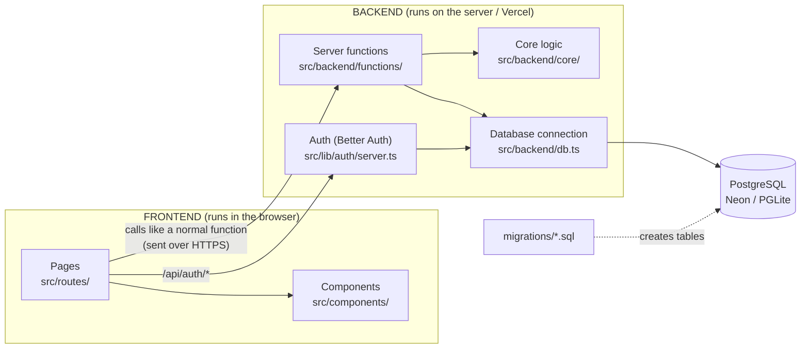
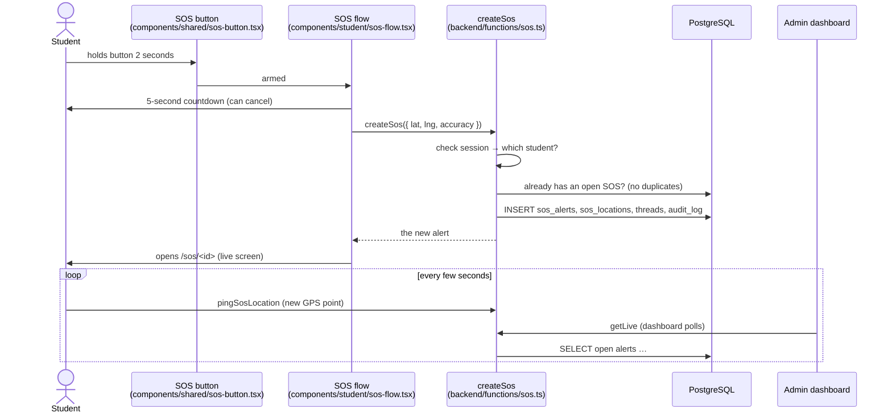

# CampusSafe — How the project is organised

This guide explains **where everything lives**, **how the frontend talks to the
backend**, and **where the database and Operating-System concepts are used**.

---

## 1. The big picture



- **Frontend** = what the user sees: pages and UI components (React).
- **Backend** = code that runs only on the server: checks who you are, applies the
  rules, reads/writes the database. The browser can never see this code.
- **Shared** (`src/lib/`) = things both sides use: data types, campus locations,
  small helpers.

The framework (TanStack Start) lets a page call a backend function **as if it were
a normal function**. Behind the scenes it becomes an HTTPS request to the server —
so the frontend never touches the database directly.

---

## 2. Folder map

```
campus-safe/
│
├── src/
│   ├── routes/                      ── FRONTEND: PAGES (file path = URL) ──
│   │   ├── __root.tsx               App shell: <html>, theme, who is signed in
│   │   ├── login.tsx                /login
│   │   ├── signup.tsx               /signup
│   │   ├── anonymous.tsx            /anonymous   (no account needed)
│   │   ├── track.$code.tsx          /track/CS-XXXX-XXXX  (follow an anonymous report)
│   │   ├── sos.$id.tsx              /sos/<id>    live SOS screen for the student
│   │   ├── forbidden.tsx            /forbidden
│   │   ├── _student/                Student area (route.tsx = guard + layout)
│   │   │   ├── index.tsx            /            home: map, medical ID, my reports
│   │   │   ├── report.tsx           /report      file an incident
│   │   │   ├── reports.index.tsx    /reports     my reports
│   │   │   └── reports.$id.tsx      /reports/<id>
│   │   ├── staff/                   Responder field app
│   │   │   ├── index.tsx            /staff       assigned alerts
│   │   │   └── $id.tsx              /staff/<id>  one alert: map, navigate, status
│   │   ├── admin/                   Admin console (route.tsx = admin-only guard)
│   │   │   ├── index.tsx            /admin       live dashboard
│   │   │   ├── sos.index.tsx        /admin/sos   live SOS map & list
│   │   │   ├── sos.$id.tsx          /admin/sos/<id>
│   │   │   ├── incidents.*.tsx      incident queue & case view
│   │   │   ├── anonymous.tsx        anonymous reports
│   │   │   ├── users.tsx            create accounts, change roles, reset passwords
│   │   │   ├── responders.tsx       responder units
│   │   │   └── analytics.tsx        charts
│   │   └── api/auth/$.ts            BACKEND endpoint for sign-in/sign-up/sessions
│   │
│   ├── components/                  ── FRONTEND: REUSABLE UI ──
│   │   ├── shared/                  Used everywhere: logo, map, SOS button, pills…
│   │   ├── auth/                    Login/sign-up page frame
│   │   ├── student/                 Student frame (tab bar), SOS flow, profile panel
│   │   ├── responder/               Responder frame
│   │   └── admin/                   Admin frame, notification bell, case panels
│   │
│   ├── backend/                     ── BACKEND ──
│   │   ├── functions/               What the frontend can call (the "API")
│   │   │   ├── sos.ts               create SOS, live location pings, assign, status
│   │   │   ├── reports.ts           incidents, anonymous reports, case messages
│   │   │   ├── profile.ts           student profile, medical ID, admin user management
│   │   │   ├── admin.ts             dashboard data, counters, notifications, analytics
│   │   │   └── viewer.ts            "who is signed in and what is their role?"
│   │   ├── core/                    Internal building blocks (never called directly)
│   │   │   ├── helpers.ts           role checks (requireAdmin…), audit log
│   │   │   ├── accounts.ts          creating password accounts
│   │   │   ├── rate-limit.ts        anti-abuse limits
│   │   │   └── seed.ts              demo data for local development
│   │   └── db.ts                    Database connection (Neon or PGLite) + migrations
│   │
│   ├── lib/                         ── SHARED (frontend + backend) ──
│   │   ├── types.ts                 Data shapes: Profile, SosAlert, Incident…
│   │   ├── campus.ts                Campus map, locations, categories, statuses
│   │   ├── roles.ts                 Which role may open which page
│   │   ├── scheduling.ts            OS scheduling: priority + aging, responder pick, semaphore limit
│   │   ├── gps.ts, use-live-location.ts   Phone GPS helpers
│   │   ├── utils.ts, theme.ts, brand.ts   Small helpers, dark mode, app name
│   │   └── auth/                    Sign-in plumbing (client.ts = browser side,
│   │                                server.ts = backend side, guards.ts = page guards)
│   │
│   ├── router.tsx                   Creates the router
│   ├── routeTree.gen.ts             AUTO-GENERATED list of pages — don't edit
│   └── styles.css                   Tailwind + theme colours (light & dark)
│
├── migrations/                      ── DATABASE SCHEMA (applied in order) ──
│   ├── 0001_auth.sql                users, sessions, accounts (Better Auth)
│   ├── 0002_schema.sql              profiles, SOS, incidents, anonymous, threads, audit
│   ├── 0003_student_role.sql        role rename
│   ├── 0004_graphic_era_campus.sql  campus locations
│   ├── 0005_student_profile.sql     course, blood group, emergency contact
│   ├── 0006_notifications_and_indexes.sql   bell "seen" state + performance indexes
│   ├── 0007_safe_walks_and_campus_alerts.sql  "walk with me" + campus broadcasts
│   ├── 0008_sos_scheduling.sql      one open SOS per student, responder semaphore count
│   └── 0009_view_trigger_foreign_keys.sql   foreign keys, updated_at trigger, open_cases view
│
├── public/                          Static files served as-is (favicon, icons)
├── scripts/                         migrate.mjs (applies migrations), dev/build helpers
├── vite.config.ts                   Build configuration
└── package.json                     Dependencies and npm commands
```

**Rule of thumb when explaining:** *routes + components = what you see,
backend = what the server does, migrations = what the database looks like.*

---

## 3. Following one request: a student sends an SOS



Every backend function follows the same pattern:

1. **Who is calling?** — `authMiddleware` reads the session cookie.
2. **Are they allowed?** — role / ownership checks (`requireAdmin`, "is this your SOS?").
3. **Is the input valid?** — `zod` schemas reject bad data (e.g. latitude 999).
4. **Do the work** — parameterised SQL (safe from SQL injection).
5. **Record it** — important actions go into `audit_log`.

---

## 4. Database (DBMS)

| Table | Holds |
| ----- | ----- |
| `user`, `session`, `account` | Sign-in data (Better Auth); passwords are stored **hashed** |
| `profiles` | Name, role (`student` / `responder` / `admin`), phone, course, medical ID |
| `sos_alerts` | One row per SOS: status, position, who is assigned, timestamps |
| `sos_locations` | Live GPS trail — many points per SOS (**foreign key**, cascade delete) |
| `incidents` | Reports filed by signed-in students |
| `anonymous_reports` | Reports with no identity — only a random tracking code |
| `threads` | Messages on a case (student ↔ command ↔ responder) |
| `responders` | Responder units |
| `audit_log` | Who did what, when — the evidence trail |
| `campus_locations`, `incident_categories` | Reference data |
| `_migrations` | Which migration files are already applied (schema versioning) |

DBMS concepts used:

- **Constraints** — primary keys, foreign keys, `CHECK` (allowed statuses,
  severities, blood groups), `UNIQUE` (tracking codes).
- **Indexes** — including **partial indexes** that only cover open cases
  (`0006_notifications_and_indexes.sql`).
- **Foreign keys** — reports point at real categories, locations and responders
  (`0009_view_trigger_foreign_keys.sql`), added `NOT VALID` then validated so old
  data can never block a deploy.
- **Trigger** — `set_updated_at()` keeps `updated_at` correct on every change to a report.
- **View** — `open_cases` combines open incidents and anonymous reports; the admin
  notification bell reads it like a table.
- **Transactions** — each migration file is applied atomically.
- **Queries** — joins, `UNION ALL`, aggregates, correlated sub-queries, a window
  function (`row_number() over (partition by …)`), `generate_series` for charts.
- **Security** — every query is parameterised; access rules are enforced on the
  server, never only by hiding buttons.

**Neon vs PGLite:** with `DATABASE_URL` set, `src/backend/db.ts` connects to Neon
(persistent cloud Postgres). Without it, it starts **PGLite** — real Postgres
compiled to WebAssembly, running **in memory** — so the app works with zero setup
(data resets on restart).

---

## 5. Operating-System concepts in the project

The scheduling rules live in one small, unit-tested file:
**`src/lib/scheduling.ts`** (tests: `src/lib/scheduling.test.ts`).

| OS concept | Where | How |
| ---------- | ----- | --- |
| Priority scheduling | `compareQueueItems` in `lib/scheduling.ts`, used by `backend/functions/admin.ts` | Live queue: SOS first, then by severity, ties first-come-first-served |
| Aging (no starvation) | `agedLevel` in `lib/scheduling.ts` | Every 30 min of waiting raises a case one level, so a P4 can't wait forever behind new P1s; the queue shows "aged P4→P2" |
| Load balancing + round-robin | `pickResponder` in `lib/scheduling.ts`, shown in the dispatch picker | Suggests the least-busy unit; ties go to the unit that has waited longest since its last alert |
| Counting semaphore | `acquireResponderSlot` / `releaseResponderSlot` in `backend/functions/sos.ts`, `responders.active_sos` (migration 0008) | Each unit holds at most 2 live SOS. Assign = P() (atomic "+1 only if below 2"), resolve = V() (−1); a CHECK keeps it ≥ 0 |
| Race conditions (fixed atomically) | `openSosForUser` in `backend/functions/sos.ts` + unique index `sos_alerts_one_open_idx` | Two simultaneous SOS presses can't create two alerts: the database rejects the second insert, which returns the first alert |
| Atomic compare-and-swap | `escalate` in `backend/functions/walks.ts`; `closeSos` in `sos.ts` | `update … where status = 'active'` — only the first of two racers wins, so a walk escalates once and a slot is released once |
| Optimistic concurrency | `assignSos` in `backend/functions/sos.ts` | Re-assignment only applies if nobody changed the alert since it was read; otherwise it is undone and the admin is asked to refresh |
| Mutual exclusion | `backend/db.ts` | Migrations run one at a time on a single promise chain, like a mutex; each runs in a transaction |
| Watchdog timer | `escalateOverdueWalks` in `backend/functions/walks.ts` | "Walk with me" turns into an SOS if the student doesn't check in on time |
| Cron / background daemon | `routes/api/cron/walks.ts` | An external scheduler runs the watchdog every minute, even with no app open |
| Shared memory / caching | Admin counters (`admin.ts`) | All open consoles share one result for 3 s |
| Resource limits / throttling | `backend/core/rate-limit.ts`, GPS ping throttle | Sliding-window limits; pings < 2 s apart are merged |
| Timers & interrupts | `components/shared/sos-button.tsx` | 2-second hold uses a real timer; releasing early cancels it |
| Buffering / spooling | `components/student/sos-flow.tsx` | Offline SOS is queued locally and retried with exponential backoff (4 s, 8 s, 15 s, 30 s) |
| Event-driven I/O | `components/admin/admin-shell.tsx` | Refreshes when the tab becomes visible instead of polling constantly |
| Volatile vs persistent storage | PGLite (RAM) vs Neon (disk) | Why local data resets but production data doesn't |
| Protection / access control | Roles + server checks | Like OS permission levels; passwords hashed |
| Process creation & signals | `scripts/run.mjs` | Starts the dev server as a child process, forwards SIGINT/SIGTERM and passes on its exit code |
| Atomic file write | `scripts/write-atomic.mjs` | Write to a temp file, then `rename()` (atomic) so nobody sees a half-written file |
| Power management | Wake Lock during SOS | Asks the phone not to sleep while sending |

Algorithms elsewhere: **Haversine** distance, a circular **geofence** and a
**nearest-neighbour** search in `lib/campus.ts`; a **top-N-per-group** query
(`row_number() over (partition by …)`) for map trails in `admin.ts`.

---

## 6. Where to change common things

| I want to… | Edit |
| ---------- | ---- |
| Change a page's layout | `src/routes/<page>.tsx` |
| Change the student tab bar / SOS button | `src/components/student/student-shell.tsx`, `components/shared/sos-button.tsx` |
| Add a backend action | a new `createServerFn` in `src/backend/functions/` |
| Add a database column/table | a new `migrations/000X_name.sql` file (never edit old ones) |
| Change campus locations or the security phone number | `src/lib/campus.ts` |
| Change colours / dark mode | `src/styles.css` |
